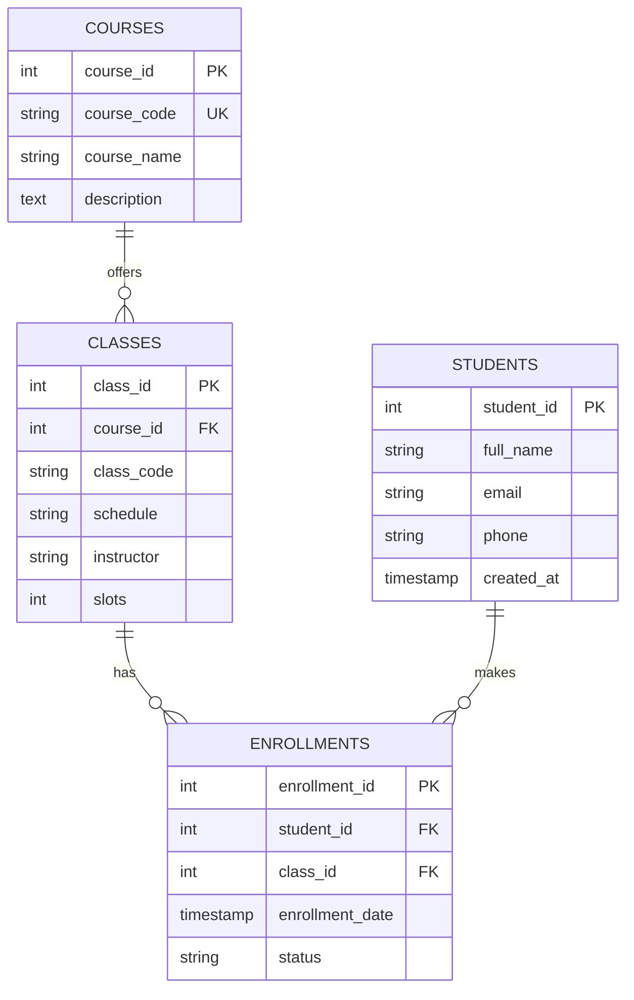

# Training Enrollment System (Multi-Table PHP PDO Application)

A robust, relational database-driven web application built with **PHP** and **PDO (PHP Data Objects)**. This application models a training institution enrollment domain where Courses, Class Sections, Students, and Enrollments are related and maintained consistently using database transactions, server-side validation, and software design patterns.

---

## 📋 Table of Contents
1. [Project Overview](#project-overview)
2. [Folder Organization](#folder-organization)
3. [Design Patterns & Architecture](#design-patterns--architecture)
   - [1. Singleton Pattern (`Database`)](#1-singleton-pattern-database)
   - [2. Repository Pattern (`EnrollmentRepository`)](#2-repository-pattern-enrollmentrepository)
   - [3. Transactional Integrity (ACID Guarantees)](#3-transactional-integrity-acid-guarantees)
4. [Database Schema & Relationships](#database-schema--relationships)
5. [Installation & Setup Instructions](#installation--setup-instructions)
6. [Feature Walkthrough & Screenshot Evidence Guide](#feature-walkthrough--screenshot-evidence-guide)
7. [Deliverables Checklist](#deliverables-checklist)

---

## 🎯 Project Overview

In this system:
- **Courses** represent training offerings (e.g., *Web Development Fundamentals*, *Relational Database Design & SQL*).
- **Classes** (Sections) represent scheduled sessions with an assigned instructor, meeting schedule, and a strict capacity limit of available slots.
- **Students** are participants registering for courses.
- **Enrollments** serve as the junction entity resolving the many-to-many relationship between Students and Classes, tracking enrollment dates and active/cancelled status.

### Core Business Rules:
- **Atomic Multi-Table Student Registration:** Recording a new student and enrolling them in a class section executes three interdependent operations inside a single database transaction:
  1. Insert into `students` table.
  2. Insert into `enrollments` table with active status.
  3. Decrement available slots in `classes` table.
- **Rollback on Capacity Exhaustion:** If a class section has zero slots remaining, the transaction is immediately rolled back. No orphaned student or enrollment records are left in the database.
- **Safe Enrollment Cancellation:** When an administrator cancels an enrollment, the status is updated to `cancelled` and the class slot count is atomically incremented by 1 inside a transaction.
- **Duplicate Prevention:** Existing students cannot be enrolled into the same class section more than once while active.

---

## 📁 Folder Organization

```text
training_enrollment/
|-- config/
|   |-- db.php                      # Creates the shared PDO connection (Singleton)
|   `-- db.example.php              # Sample configuration template without credentials
|-- classes/
|   |-- Database.php                # CORE: PDO wrapper implementing Singleton pattern
|   |-- Pet.php                     # CORE: Reference PDO CRUD example
|   |-- Student.php                 # Student data access (find, all, record)
|   |-- Course.php                  # Course catalog management (CRUD)
|   |-- ClassSection.php            # Class section scheduling and slot management
|   `-- EnrollmentRepository.php    # Repository managing transactional enrollments & cancels
|-- admin/
|   |-- courses.php                 # Manage courses (Add, Edit, Delete, Search)
|   |-- classes.php                 # Manage class schedules and capacity slots
|   |-- students.php                # Student registration form (multi-table transaction)
|   |-- enroll.php                  # Enroll existing student (transactional)
|   |-- enrollments.php             # View all enrollments (multi-table JOINs) + Cancel action
|   `-- reports.php                 # Summative capacity and popularity reports
|-- includes/
|   |-- header.php                  # Shared navigation header
|   `-- footer.php                  # Shared footer component
|-- css/
|   `-- style.css                   # Custom responsive styling and UI components
|-- sql/
|   `-- schema.sql                  # Database schema DDL + initial seed records
|-- training_db.sql                 # Complete database export
|-- index.php                       # Landing dashboard
`-- README.md                       # Comprehensive documentation
```

---

## 🏛️ Design Patterns & Architecture

### 1. Singleton Pattern (`Database`)
- **Class:** `Database` (extends `PDO`)
- **Implementation:** Private constructor, static `$instance` property, and public static `getInstance($dsn, $user, $pass)`.
- **Rationale & Benefits:**
  - **Connection Efficiency:** Opening a new database connection for every class or page request is computationally expensive and quickly exhausts database connection pools.
  - **Single Shared Instance:** The Singleton pattern ensures that exactly one database connection exists across the entire request lifecycle, conserving server memory and database handles.
  - **Consistent Configuration:** Error mode (`PDO::ERRMODE_EXCEPTION`) and default fetch mode (`PDO::FETCH_ASSOC`) are uniformly enforced on the single instance.

### 2. Repository Pattern (`EnrollmentRepository`)
- **Class:** `EnrollmentRepository`
- **Implementation:** Receives the shared `PDO` instance via Dependency Injection (`__construct(PDO $db)`). Exposes business-oriented methods: `recordStudent()`, `enroll()`, `cancel()`, and `allWithDetails()`.
- **Rationale & Benefits:**
  - **Separation of Concerns:** Presentation files (`admin/students.php`, `admin/enrollments.php`) only handle HTTP requests and user feedback; they do not contain raw SQL statements.
  - **Encapsulation of Complex Business Logic:** Multi-table joins, concurrency row locking (`FOR UPDATE`), and transaction boundaries are centralized in one maintainable data-access layer.
  - **Testability & Reusability:** The repository methods can be called by CLI test scripts, REST API endpoints, or web forms without rewriting SQL queries.

### 3. Transactional Integrity (ACID Guarantees)
- **Atomicity:** In `recordStudent()`, the student insert, enrollment insert, and slot decrement either all commit successfully or all roll back together if any step fails or if capacity is full.
- **Consistency:** Foreign key constraints (`FOREIGN KEY (student_id) REFERENCES students(student_id)`, `FOREIGN KEY (class_id) REFERENCES classes(class_id)`) ensure referential integrity.
- **Isolation:** Transactional queries utilize `SELECT ... FOR UPDATE` row locks to prevent race conditions during concurrent enrollments.
- **Durability:** With MySQL InnoDB storage engine, all committed transactions are permanently written to transaction logs.

---

## 🗄️ Database Schema & Relationships



---

## ⚙️ Installation & Setup Instructions

### Prerequisites
- **XAMPP** (or WampServer / LAMP) with **PHP 8.0+** and **MySQL / MariaDB**.
- Apache and MySQL services running in the XAMPP Control Panel.

### Step 1: Place in Web Root
Clone or copy the project into your Apache document root:
```text
C:\xampp\htdocs\training_enrollment\
```

### Step 2: Import the Database
1. Open your browser and navigate to **phpMyAdmin**: `http://localhost/phpmyadmin`
2. Create a new database named `training_db` (or run `sql/schema.sql`).
3. Click **Import** and select `sql/schema.sql` (or `training_db.sql`), then click **Go**.
*Alternatively via Command Line:*
```powershell
C:\xampp\mysql\bin\mysql.exe -u root < "C:\xampp\htdocs\training_enrollment\sql\schema.sql"
```

### Step 3: Configure Database Credentials
Verify `config/db.php`:
```php
$dsn = "mysql:host=localhost;dbname=training_db;charset=utf8mb4";
$user = "root";
$pass = ""; // default for XAMPP
```

### Step 4: Access the Application
Open your web browser and navigate to:
```text
http://localhost/training_enrollment/
```

---

## 📸 Feature Walkthrough & Screenshot Evidence Guide

When assembling your documentation (Section 11 of activity specifications), include full-width captures for the following 9 requirements:

| # | Requirement | Where to Capture | What to Demonstrate |
|---|---|---|---|
| **1** | **Course Management** | `http://localhost/training_enrollment/admin/courses.php` | Full page showing the table of courses with code, course title, description, and action buttons. |
| **2** | **Add / Edit Course Form** | `http://localhost/training_enrollment/admin/courses.php` | The form filled in with a new/edited course, followed by the updated table list with the new entry. |
| **3** | **Class Management** | `http://localhost/training_enrollment/admin/classes.php` | Classes table listing class sections with course name, schedule, instructor, and current slots badge. |
| **4** | **Student Recording Form** | `http://localhost/training_enrollment/admin/students.php` | The registration form filled in with student details (name, email, phone) and selected class section. |
| **5** | **Successful Recording** | `http://localhost/training_enrollment/admin/students.php` | Green success alert message confirming student insertion, enrollment creation, and class slots decremented by 1. |
| **6** | **Enrollments List** | `http://localhost/training_enrollment/admin/enrollments.php` | Table showing enrollment records with full multi-table JOINs (Student, Course, Class, Schedule, Status). |
| **7** | **Cancelled Enrollment** | `http://localhost/training_enrollment/admin/enrollments.php` | Clicking "Cancel Enrollment", showing status changed to `cancelled` and the class slot count restored. |
| **8** | **Rollback Case** | `http://localhost/training_enrollment/admin/students.php` | Attempting to record a student into a class with `0 slots` (e.g. `WD101-SEC2`), displaying the rollback failure notice with zero orphaned rows. |
| **9** | **Database Evidence** | phpMyAdmin (`training_db`) | phpMyAdmin tables (`students`, `enrollments`, `classes`) displaying the committed and consistent records. |

---

## ✅ Deliverables Checklist

- [x] **1. Working Multi-Table Application:** Implemented across `config/`, `classes/`, `admin/`, `includes/`, and `css/`.
- [x] **2. Completed `EnrollmentRepository`:** Fully transactional `recordStudent()`, `enroll()`, and `cancel()`.
- [x] **3. Design Patterns Documentation:** Complete write-up on Singleton and Repository patterns.
- [x] **4. Database Export (`training_db.sql`):** Exported and saved in the root project folder.
- [x] **5. Comprehensive `README.md`:** Setup guide, schema, and design patterns.
- [x] **6. Google Document Guide:** Ready structure for copying into a shareable Google Doc with screenshot evidence.
- [x] **7. Git Repository Prepared:** Ready for push to GitHub with clean commits.
